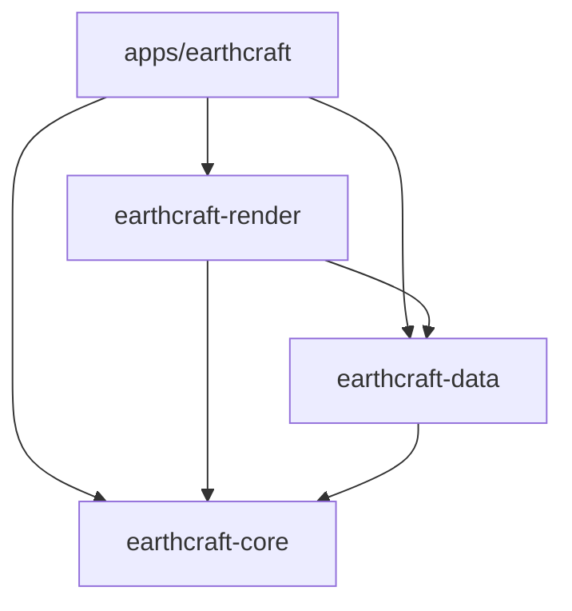

# Architecture

[English](ARCHITECTURE.md) | [Português (Brasil)](ARCHITECTURE.pt-BR.md)

EarthCraft is a Cargo workspace with one desktop application and three libraries.
The split preserves the existing globe, services, controls, and UI.

Arrows mean Cargo dependencies. Libraries never depend on the application.

| Package | Responsibility | Main entry points |
| --- | --- | --- |
| `earthcraft` | Native window, input, UI state and orchestration | `apps/earthcraft/src/main.rs`, `app/mod.rs` |
| `earthcraft-core` | Globe math, camera, language, placemark values | `camera`, `math`, `language`, `placemark` |
| `earthcraft-data` | Network services, tile cache, boundary data, settings and KML | `tiles`, `wayback`, `boundaries`, `search`, `settings`, `kml` |
| `earthcraft-render` | Parallel CPU ray casting and missing-tile prioritization | `RenderCfg`, `render_frame` |

The workspace root owns dependency versions, shared package metadata, build
profiles, and the lockfile. `apps/earthcraft` is the default member, so
`cargo run --release` still starts the desktop app from the root. Use
`--workspace` for checks that must cover all libraries and their tests.
Root `assets/` stays shared; the embedded icon path is relative to the moved
launcher. Application packaging metadata stays in its own manifest.

## Desktop modules

`app/mod.rs` contains private application state, construction, and the eframe
update loop. Child modules extend that state through focused `impl App` blocks:

- `navigation`: camera commands, language changes, and fly-to animation.
- `search`: asynchronous search, suggestion polling, and selection.
- `wayback`: historical imagery loading and selected release state.
- `files`: native dialogs, KML commands, dropped files, and screenshots.
- `globe`: viewport interaction, redraw decisions, and image presentation.
- `rendering`: builds renderer inputs and uploads returned pixels to egui.
- `overlays`: merges boundary patches and draws borders, labels and ruler marks.
- `ui/`: bars, sidebar, suggestions, settings, and navigation controls.

Keeping state in the parent lets child modules access it without exporting it to
other crates. Methods used by sibling modules have restricted app visibility.
Widgets call existing app commands; camera math is tested in core directly.

## Data and rendering flow

1. The app handles input and updates its camera and visible-layer state.
2. Core calculates camera basis vectors, projection and cursor picking. It uses
   `emath`'s lightweight `Pos2`/`Rect` types, also re-exported by egui, without
   depending on widgets or a windowing backend.
3. The renderer ray-casts rows in parallel with Rayon. It samples cached tiles,
   blends imagery zoom levels, and applies the grid, atmosphere, sunlight and stars.
4. Missing tiles are queued with the original priority: lower zoom first, then
   distance to the screen center. The data crate retains six tile workers, the
   in-flight limit, retry delay, and disk caching behavior.
5. The app injects a thread-safe repaint callback into `TileCache::new`. Workers
   signal completion through that callback; data does not import egui.
6. The app uploads RGBA output to a texture and draws geographic overlays.
7. Boundary, search and historical-imagery workers return results through channels.
   The UI update loop polls and applies them. Network calls stay off the UI thread.

Cache generation and in-flight counts are exposed through read-only methods.
Tile maps, queues and atomics stay private. HTTP cache helpers and persistence
paths stay private to data. Search and boundary deduplication reuse core's
existing name-normalization function.

## Preserved contracts

- Latitude/longitude values remain degrees; camera altitude and globe distances
  remain kilometers; rasterization uses the existing meter conversion.
- KML/GeoJSON coordinate arrays remain longitude first; internal geographic
  points remain `(latitude, longitude)`.
- Cache locations remain `LOCALAPPDATA`, then `XDG_CACHE_HOME`, then
  `HOME/.cache`, then the temporary directory, under `earthcraft_tiles`.
- Existing `lang.txt`, `settings.json`, tile directories and output-folder
  defaults remain unchanged. No data migration is necessary.
- Provider URLs, attribution, imagery release order, label zoom thresholds,
  control bindings, UI wording and request behavior are retained.

## Extending the project

A camera operation belongs in core with a geometry test. A new service or file
format belongs in data, with parsing tests using local inputs. Pixel shading or
sampling belongs in render; panel layout and event wiring belong in the app.
Keep feature-specific state near its commands; extract a state object when it
owns meaningful behavior, rather than creating a crate for every panel.

Avoid making the renderer responsible for egui textures or adding callbacks
from core into the UI. Introduce interfaces at actual service boundaries when
needed, rather than wrapping every function in a trait.

## Deliberately retained implementation constraints

This is an architectural refactor, not a rewrite of the existing subsystems.
Historical imagery still uses a synchronized process-wide release list. Tile
workers retain their original application-lifetime ownership. KML still uses the
existing lightweight parser and supports its existing subset. App state is still
one private owner shared by its child modules. These are future work candidates;
changing them should be a separate change with its own behavior and lifecycle tests.

Packaging metadata previously referenced `icon.icns` and
`packaging/earthcraft.desktop`, which are absent from this repository. Paths now
point to their original root locations, but packaging remains unverified until
those assets are supplied. The executable's existing PNG icon is present.

## Constants and dependency choices

Shared physical units and camera bounds are named in `earthcraft-core/src/lib.rs`.
Numerical tolerances and solar coefficients stay with their mathematical model.
Renderer shading/LOD parameters live in its private `tuning` module. Cache policy,
packed tile-key fields, request limits and timeouts belong to data. UI geometry,
colors, animation durations and redraw/debounce thresholds belong to the app.

Names include units where applicable. Egui points and raster pixels are different
units. Values that happen to coincide are shared only when they have the same
meaning: search's 111.2 km/degree approximation remains distinct from the
renderer/camera's 111,195 meters/degree. The UI slider's maximum of 2.0 also
remains distinct from the persisted setting's supported maximum of 2.5.
Obvious algebraic numbers stay in the formulas; policy and model parameters get
names without changing their values or floating-point evaluation order.

See [library options](LIBRARY_OPTIONS.md) for focused ways to remove handwritten
parsing, error and vector boilerplate in follow-up changes.
