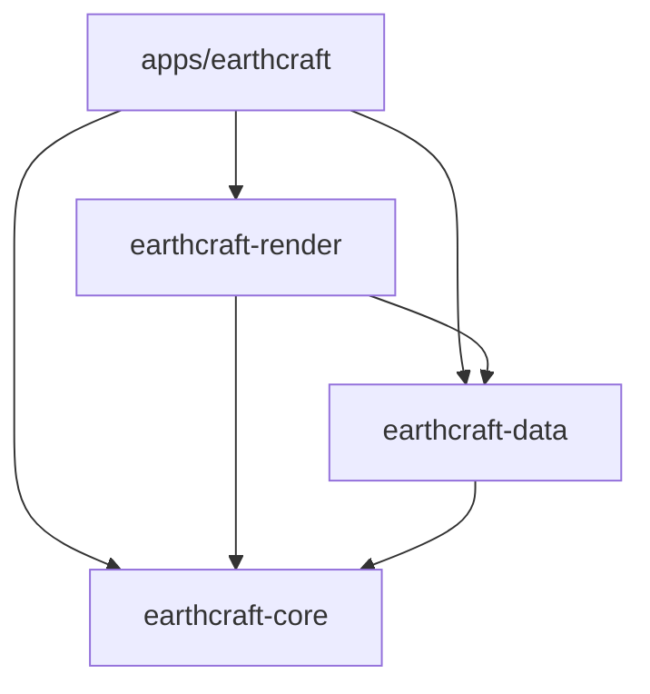

# Architecture

[English](ARCHITECTURE.md) | [Português (Brasil)](ARCHITECTURE.pt-BR.md)

EarthCraft is a Cargo workspace with one desktop application and three libraries.
The split preserves the existing globe, services, controls, and UI.

Arrows mean Cargo dependencies. Libraries never depend on the application.

| Package | Responsibility | Main entry points |
| --- | --- | --- |
| `earthcraft` | Native window, input, UI state and orchestration | `apps/earthcraft/src/main.rs`, `app/mod.rs` |
| `earthcraft-core` | Globe math, camera, language, placemark values | `camera`, `math`, `language`, `placemark` |
| `earthcraft-data` | Network services, tile cache, boundary data, settings and KML | `tiles`, `wayback`, `boundaries`, `search`, `settings`, `kml` |
| `earthcraft-render` | Parallel CPU ray casting and missing-tile prioritization | `RenderCfg`, `render_frame` |

The workspace root owns dependency versions, shared package metadata, build
profiles, and the lockfile. `apps/earthcraft` is the default member, so
`cargo run --release` still starts the desktop app from the root. Use
`--workspace` for checks that must cover all libraries and their tests.
Root `assets/` stays shared; the embedded icon path is relative to the moved
launcher. Application packaging metadata stays in its own manifest.

## Desktop modules

`app/mod.rs` contains private application state, construction, and the eframe
update loop. Child modules extend that state through focused `impl App` blocks:

- `navigation`: camera commands, language changes, and fly-to animation.
- `search`: asynchronous search, suggestion polling, and selection.
- `wayback`: historical imagery loading and selected release state.
- `files`: native dialogs, KML commands, dropped files, and screenshots.
- `cache`: disk-cache clearing commands and completion polling.
- `globe`: viewport interaction, redraw decisions, and image presentation.
- `rendering`: builds renderer inputs and uploads returned pixels to egui.
- `overlays`: merges boundary patches and draws borders, labels and ruler marks.
- `ui/`: bars, sidebar, suggestions, settings, and navigation controls.

Keeping state in the parent lets child modules access it without exporting it to
other crates. Methods used by sibling modules have restricted app visibility.
Widgets call existing app commands; camera math is tested in core directly.

## Data and rendering flow

1. The app handles input and updates its camera and visible-layer state.
2. Core calculates camera basis vectors, projection and cursor picking. It uses
   `emath`'s lightweight `Pos2`/`Rect` types, also re-exported by egui, without
   depending on widgets or a windowing backend.
3. The renderer ray-casts eight-row batches in parallel with Rayon. Each batch
   shares tile lookups and handles across adjacent rows, then releases them at
   completion. It samples cached tiles,
   blends imagery zoom levels, and applies the grid, atmosphere, sunlight and stars.
4. Missing tiles are queued with the original priority: lower zoom first, then
   distance to the screen center. The data crate runs six async tile workers, preserving the
   in-flight limit, retry delay, and disk caching behavior. Once visible requests
   are admitted, the app pumps a bounded satellite overview warmup while idle at
   the initial altitude or farther away.
5. The app injects a thread-safe repaint callback into `TileCache::new`. Workers
   signal completion through that callback; data does not import egui.
6. The app uploads RGBA output to a texture and draws geographic overlays.
7. Boundary, search and historical-imagery workers return results through channels.
   The UI update loop polls and applies them. Network calls stay off the UI thread.

Cache generation and in-flight counts are exposed through read-only methods.
Tile maps, queues and atomics stay private. HTTP cache helpers and persistence
paths stay private to data. Search and boundary deduplication reuse core's
existing name-normalization function.

## Preserved contracts

- Latitude/longitude values remain degrees; camera altitude and globe distances
  remain kilometers; rasterization uses the existing meter conversion.
- KML/GeoJSON coordinate arrays remain longitude first; internal geographic
  points remain `(latitude, longitude)`.
- Cache locations remain `LOCALAPPDATA`, then `XDG_CACHE_HOME`, then
  `HOME/.cache`, then the temporary directory, under `earthcraft_tiles`.
- Existing `lang.txt`, `settings.json`, tile directories and output-folder
  defaults remain unchanged. No data migration is necessary.
- Provider URLs, attribution, imagery release order, label zoom thresholds,
  control bindings and UI wording are retained. Startup satellite overview
  warming adds background requests; other providers remain on demand.

## Extending the project

A camera operation belongs in core with a geometry test. A new service or file
format belongs in data, with parsing tests using local inputs. Pixel shading or
sampling belongs in render; panel layout and event wiring belong in the app.
Keep feature-specific state near its commands; extract a state object when it
owns meaningful behavior, rather than creating a crate for every panel.

Avoid making the renderer responsible for egui textures or adding callbacks
from core into the UI. Introduce interfaces at actual service boundaries when
needed, rather than wrapping every function in a trait.

## Deliberately retained implementation constraints

Historical imagery still uses a synchronized process-wide release list. KML uses
quick-xml while retaining the existing Point subset. App state remains one private
owner shared by child modules. Feature extensions to these boundaries need their
own behavior and lifecycle tests.

Packaging metadata previously referenced `icon.icns` and
`packaging/earthcraft.desktop`, which are absent from this repository. Paths now
point to their original root locations, but packaging remains unverified until
those assets are supplied. The executable's existing PNG icon is present.

## Constants and dependency choices

Shared physical units and camera bounds are named in `earthcraft-core/src/lib.rs`.
Numerical tolerances and solar coefficients stay with their mathematical model.
Renderer shading/LOD parameters live in its private `tuning` module. Cache policy,
packed tile-key fields, request limits and timeouts belong to data. UI geometry,
colors, animation durations and redraw/debounce thresholds belong to the app.

Names include units where applicable. Egui points and raster pixels are different
units. Values that happen to coincide are shared only when they have the same
meaning: search's 111.2 km/degree approximation remains distinct from the
renderer/camera's 111,195 meters/degree. The UI slider's maximum of 2.0 also
remains distinct from the persisted setting's supported maximum of 2.5.
Obvious algebraic numbers stay in the formulas; policy and model parameters get
names without changing their values or floating-point evaluation order.

See [library choices](LIBRARY_OPTIONS.md) for the adopted dependencies and their
compatibility constraints. Core uses glam double-precision camera matrices,
quaternions and vectors. `dcamera::rh::view::look_to_mat3` builds the view rotation;
`dcamera::rh::proj::directx::perspective_infinite` builds the perspective matrix.
World/view rotations and projection are cached when constructing a camera basis.
World geometry is right-handed with geographic north along +Z; view space is
X-right/Y-up/-Z-forward. NDC Y is up and the final screen conversion inverts it.
The `directx` constructor selects a depth convention, not a graphics backend;
the CPU renderer does not use projected depth for clipping. It retains the
existing field of view, analytic ray/sphere picking and geographic horizon test.

Tile interpolation, zoom blending, sunlight, atmosphere and output clamping keep
RGB in SIMD `Vec4` lanes until byte conversion. The fourth lane stays zero and
output alpha remains opaque. `lerp_monotonic` expresses the original interpolation
form; supported targets may fuse operations, so the unchanged original raster
fixtures retain their existing one-step quantization tolerance. Bytemuck supplies
safe byte-aligned RGBA views without pixel copies or SIMD-alignment assumptions.

## Network runtime

The desktop app owns `ServiceRuntime`; data receives its handle. Tokio runs tile,
search, historical imagery and boundary fetching through pooled reqwest clients.
The app still polls its existing result channels and receives repaint callbacks.
Network/file I/O is async; image decoding and JSON parsing use blocking tasks so
large inputs cannot monopolize an async worker. Rasterization continues on Rayon.
The async transport is tested against local HTTP fixtures, not public services.

## Memory policy

Decoded tiles use `moka::sync::Cache` with LRU eviction and a 256 MiB weighted
capacity target. Each entry is weighed by its RGBA pixel-buffer length. Capacity
is best-effort: inserts can temporarily overshoot while maintenance catches up.
`resident_bytes()` reports Moka's weighted estimate, which can lag recent changes;
it is not an exact live-allocation measurement. Temporary renderer references,
request bodies, geometry, textures and cache metadata are separate allocations.
The target does not allocate all 256 MiB at startup. It leaves about 171 MiB for
detailed tiles after the global overview, reducing reloads when revisiting views.

Ready-tile lookups return shared `Arc<Tile>` handles through Moka without taking
our request mutex. Loading/failed metadata uses a separate small map to preserve
request deduplication, the 48-request limit and the 15-second retry delay. Failed
or oversized tiles do not enter the decoded cache. Completion advances generation
and wakes the UI. Tile workers use weak cache ownership while idle. The existing
packed-key hasher and disk-cache contracts are retained; Moka's default TinyLFU
admission policy is explicitly replaced with LRU for map browsing.

`TileWarmup` visits satellite zooms 0–4 once per session, coarse levels first:
341 standard 256×256 RGBA tiles total about 85 MiB. They use the same decoded
cache target and disk cache; no separate pinned cache bypasses the byte budget.
Warmup admits work only while total in-flight requests are below two, leaving
four of the six workers available for visible demand. The app pumps it after
viewport request admission, with a 100 ms wakeup while work remains. It pauses
during input, below the initial 14,000 km altitude, or on another provider. Ready,
loading and recent failed tiles are skipped; failures retain normal on-demand
retry behavior. Closing the app drops the plan with its state.

Once warm, global overview rotation avoids waiting for new satellite tiles.
The first cold launch still downloads them progressively; larger viewports can
request higher-resolution detail after input stops. Closer zooms and memory
eviction can require new loads. This removes overview fetch/decode delays, not
CPU rasterization, texture upload or geographic-overlay work. Streets, topography
and historical imagery are not globally prefetched. The public OSM service
[prohibits prefetching](https://operations.osmfoundation.org/policies/tiles/).

Settings offers **Clear on-disk cache** for downloaded imagery. The data-owned
`DiskCache` removes only the four provider directories, preserving settings,
language, boundary caches and personal files. Clearing runs asynchronously;
the button is disabled until completion, and results reach the normal status bar.
The adjacent usage readout sums encoded file lengths in the same provider directories,
excluding settings, boundary data and filesystem allocation overhead. Measurement
runs on a blocking worker, coordinated with clearing, and refreshes at most once
every five seconds while Settings is open, plus after clearing. No scan runs in
the UI or pixel loops, and closed Settings does not schedule further scans.
Decoded Moka tiles remain available. The app cancels the remaining overview plan
for that session so clearing does not trigger speculative downloads immediately.
Future visible misses and the next startup may download tiles again.

An async read/write gate coordinates this instance's disk reads/writes with
clearing. Each request captures the disk epoch at admission; clearing advances
it, so queued and active old jobs can complete into RAM but cannot restore deleted
files. Provider symlinks are removed without following their targets. Cache writes
retain best-effort behavior; clear failures are reported in English. This is
in-process coordination, not a lock between multiple running applications.
The current persistent cache remains individual tile files; MBTiles and a disk
size budget are proposed later stages and are not implemented yet.

Startup loads world countries, states and populated-place labels. Brazilian
municipality labels are requested below their existing 300 km visibility limit;
municipal/metropolitan geometry starts when either layer is enabled. Labels-only
loading does not retain polygon lines. A later geometry request upgrades the
loaded data once. Geographic lines use shared `Arc<Vec<_>>` storage so overlays
and metropolitan construction do not duplicate coordinate arrays.

Large GeoJSON downloads stream into temporary files, then Serde projects one
feature at a time on blocking workers. Cache files are replaced only after valid
parsing; temporary files are cleaned up, and a writable cache is not required.
At most two feature jobs run concurrently, and Brazilian states are processed
sequentially. The service runtime also bounds blocking workers.

## Localization

Core embeds Fluent resources for `en` and `pt-BR`. Static labels are formatted
once and cached; dynamic messages use named variables, with English fallback.
The concurrent bundle also supports KML fallback names in background importers.
Locale persistence and native language names retain their existing values.
Geographic names remain service data, rather than catalog keys. Application-owned diagnostic logs and error messages use English, even in
Portuguese mode. Underlying external error details retain their original text.
See [localization](LOCALIZATION.md) for editing catalogs and regression fixtures.
