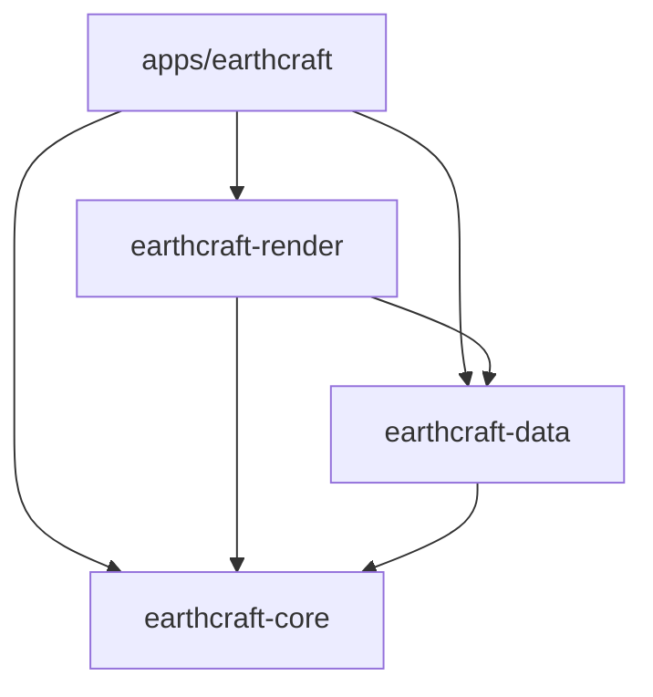

# Architecture

[English](ARCHITECTURE.md) | [Português (Brasil)](ARCHITECTURE.pt-BR.md)

EarthCraft is a Cargo workspace with one desktop application and three libraries.
The split preserves the existing globe, services, controls, and UI.

Arrows mean Cargo dependencies. Libraries never depend on the application.

| Package | Responsibility | Main entry points |
| --- | --- | --- |
| `earthcraft` | Native window, input, UI state and orchestration | `apps/earthcraft/src/main.rs`, `app/mod.rs` |
| `earthcraft-core` | Globe math, camera, language, placemark values | `camera`, `math`, `language`, `placemark` |
| `earthcraft-data` | Network services, tile cache, boundary data, settings and KML | `tiles`, `wayback`, `boundaries`, `search`, `settings`, `kml` |
| `earthcraft-render` | CPU rasterization, frame scheduling, geographic overlays and tile prioritization | `RenderCfg`, `render_frame`, `worker`, `overlays` |

The workspace root owns dependency versions, shared package metadata, build
profiles, and the lockfile. `apps/earthcraft` is the default member, so
`cargo run --release` still starts the desktop app from the root. Use
`--workspace` for checks that must cover all libraries and their tests.
Root `assets/` stays shared; the embedded icon path is relative to the moved
launcher. Application packaging metadata stays in its own manifest.

## Desktop modules

`app/mod.rs` contains private application state, construction, and the eframe
update loop. Child modules extend that state through focused `impl App` blocks:

- `navigation`: camera commands, language changes, and UI timing of core flight animation.
- `search`: asynchronous search, suggestion polling, and selection. Data owns
  local match ranking, deduplication and merging with remote results.
- `wayback`: historical imagery loading and selected release state.
- `files`: native dialogs, KML commands, dropped files, screenshot submission
  and application of background file results. Data owns the bounded ordered
  KML/PNG service; no KML parsing or PNG encoding runs on egui's thread.
- `cache`: disk-cache clearing commands and completion polling.
- `globe`: viewport interaction, redraw decisions, and image presentation.
- `rendering`: snapshots renderer inputs, owns the frame coordinator, and uploads
  completed pixels to egui. The render crate
  owns the bounded frame mailbox and accepts an injected repaint callback.
- `overlays`: applies prepared boundary snapshots and draws borders, labels and ruler marks.
  Its private `cache` retains one
  egui shape view; `projected` measures fonts and builds styled border/text shapes
  from background-prepared geometry.
  Geographic projection, visibility indexing, ordered label candidates and
  rectangle occupancy belong to `earthcraft-render::overlays`.
- `ui/`: bars, sidebar, suggestions, settings, and navigation controls.

Keeping state in the parent lets child modules access it without exporting it to
other crates. Methods used by sibling modules have restricted app visibility.
Widgets call existing app commands; camera math is tested in core directly.

## Data and rendering flow

1. The app handles input and updates its camera and visible-layer state.
2. Core calculates camera basis vectors, projection and cursor picking. It uses
   `emath`'s lightweight `Pos2`/`Rect` types, also re-exported by egui, without
   depending on widgets or a windowing backend.
3. A dedicated render-owned coordinator calls the renderer off the UI thread. The
   renderer ray-casts eight-row batches in parallel with Rayon. Each batch
   constructs and intersects four independent f64 rays at a time using `wide`.
   Geographic conversion and tile/LOD selection remain scalar. Partial groups
   shade only real pixels and never request tiles for padded lanes. Each row batch
   shares tile lookups and handles across adjacent rows, then releases them at
   completion. It samples cached tiles,
   blends imagery zoom levels, and applies the grid, atmosphere, sunlight and stars.
4. Missing tiles are queued with the original priority: lower zoom first, then
   distance to the screen center. The data crate runs six async tile workers, preserving the
   in-flight limit, retry delay, and disk caching behavior. Once visible requests
   are admitted, the app pumps a bounded satellite overview warmup while idle at
   the initial altitude or farther away.
5. The app injects a thread-safe repaint callback into `TileCache::new`. Workers
   signal completion through that callback; data does not import egui.
6. The coordinator converts RGBA into the app-provided CPU image type and prepares
   matching overlay geometry before publishing the frame and waking egui. The app
   submits the texture and lays out/draws geographic labels on the UI thread.
7. The data-owned boundary processor merges patches, deduplicates labels and
   prepares immutable dataset/name snapshots. The UI swaps the latest snapshot;
   search and historical-imagery workers also return results through channels.
   The UI update loop polls and applies them. Network calls stay off the UI thread.

Cache generation and in-flight counts are exposed through read-only methods.
Tile maps, queues and atomics stay private. HTTP cache helpers and persistence
paths stay private to data. Search and boundary deduplication reuse core's
existing name-normalization function.

The frame mailbox holds at most one active job, one replaceable pending request,
and one completed buffer. New camera positions replace pending work rather than
queuing every input event. Completed buffers supersede unread older buffers.
Provider, historical release, raster size/aspect, grid, atmosphere and sunlight
changes reject incompatible results both at publication and UI polling. During
continuous camera motion, a completed compatible view may be displayed while the
newest one renders; discarding every earlier camera snapshot would starve the
display. Borders, labels and the scale bar use that frame's camera snapshot to
stay aligned. The existing interaction/idle resolutions and tile redraw interval
remain. RGBA-to-egui conversion runs through a backend-specific preparation callback
on the coordinator; render itself has no egui dependency. Overlay index construction,
culling, border projection and stable label-candidate sorting also run in background
jobs. Font measurement, final label occupancy and shape construction remain on the UI thread.
Unavailable tile keys accompany each completed frame; only relevant successful
arrivals trigger another raster. Overlay-only toggles do not change raster state.
Displayed RGBA buffers use shared immutable ownership. Screenshot jobs clone an
`Arc`, retaining the exact displayed pixels without copying them at submission.
Previous buffers return to the worker for reuse when uniquely owned; a pending
export can temporarily prevent reuse. Same-size texture
updates preserve storage through partial uploads; resizing allocates new storage.

Administrative border and label shapes are cached for one displayed projection.
The key includes the full camera basis, viewport position/size, altitude, DPI,
visible administrative layers, language and map text scale; every merged boundary
snapshot explicitly invalidates it. Tile completion and unrelated UI repaints reuse
these shapes and shared text galleys. Movement replaces the previous cached view,
rather than retaining a history of views. Camera-driven geometry accompanies its
matching raster so continuous motion does not starve overlays. Stationary layer
or dataset changes use a render-owned worker with one active job, one replaceable
pending view and one completed result. The app accepts only matching camera,
viewport, layer and dataset results; it never draws stale projections while a
replacement is pending. Preparation caches the last geometry and static index.
Ruler and placemark drawing remains
dynamic, so edits appear immediately.

During rebuild, labels are collected and stably sorted by the existing feature
priority and rank. A `rstar` R*-tree stores accepted label rectangles; inclusive
intersection rejects touching edges exactly like egui. Padding, text layout,
colors, placement order and the 500-label cap are unchanged. The rstar tree only serves
screen-space occupancy; it does not approximate geographic visibility, change
dateline/pole handling, or change which data loads. Internal traversal stops at
the first intersection without allocating an iterator stack. The index is dropped
after rebuild. Tiny capped workloads can favor a linear scan; the reproducible
benchmark reports that tradeoff separately from projection-cache reuse.

A packed `geo-index` tree separately indexes immutable boundary lines by world
X/Y bounds. Bounds include the full wrapped latitude/longitude interpolation,
not just endpoints. Horizon-cap queries and conservative 3D horizon/frustum
plane tests reject whole lines before geographic conversion and projection.
Surviving lines retain source order and the original segment simplification and
horizon sampling. Boundary patches rebuild this static index; camera movement
only queries it. Label priority and occupancy continue to use mutable `rstar`.

The coordinator holds no mailbox lock during rasterization. Short, bounded tile
admission is synchronized with publication so incompatible frames cannot fetch
tiles. Current-view requests move ahead of queued work; stale queued detail is
retired without a failure delay, while active work and coarse overview tiles
remain. Channel messages wake workers; they take jobs from the current queue.
It admits visible missing tiles before becoming idle; overview warmup waits for
that idle state. Shutdown drops pending/completed work and wakes the coordinator
without waiting on egui; an active job finishes before releasing worker resources.
The existing Rayon pool handles pixel parallelism, without creating a new pool
per frame or occupying Tokio's bounded parsing/decoding workers.

## Preserved contracts

- Latitude/longitude values remain degrees; camera altitude and globe distances
  remain kilometers; rasterization uses the existing meter conversion.
- KML/GeoJSON coordinate arrays remain longitude first; internal geographic
  points remain `(latitude, longitude)`.
- Cache locations remain `LOCALAPPDATA`, then `XDG_CACHE_HOME`, then
  `HOME/.cache`, then the temporary directory, under `earthcraft_tiles`.
- Existing `lang.txt`, `settings.json`, tile directories and output-folder
  defaults remain unchanged. No data migration is necessary.
- Provider URLs, attribution, imagery release order, label zoom thresholds,
  control bindings and UI wording are retained. Startup satellite overview
  warming adds background requests; other providers remain on demand.

## Extending the project

A camera operation belongs in core with a geometry test. A new service or file
format belongs in data, with parsing tests using local inputs. Pixel shading or
sampling belongs in render; panel layout and event wiring belong in the app.
Keep feature-specific state near its commands; extract a state object when it
owns meaningful behavior, rather than creating a crate for every panel.

Avoid making the renderer responsible for egui textures or adding callbacks
from core into the UI. Introduce interfaces at actual service boundaries when
needed, rather than wrapping every function in a trait.

## Deliberately retained implementation constraints

Historical imagery still uses a synchronized process-wide release list. KML uses
GeoRust's `kml` reader/writer, backed by quick-xml, in `data::kml`. Its private
XML preparation pass removes empty Points, balances incomplete outer containers,
and wraps legacy bare Placemark coordinates. It bounds XML depth and rejects
truncated text fields before the library can panic or loop at EOF; no legacy
KML decoder runs in parallel. The app still imports one marker at a Placemark's
first coordinate and exports Point placemarks, without adding line/polygon or
KMZ features. The typed reader interprets CDATA literally and reports invalid
coordinates/metadata through `Error::Kml`; the old ad hoc numeric filtering and
extra entity decoding inside CDATA are removed. App state remains one private
owner shared by child modules. Feature extensions to these boundaries need their
own behavior and lifecycle tests.

Packaging metadata previously referenced `icon.icns` and
`packaging/earthcraft.desktop`, which are absent from this repository. Paths now
point to their original root locations, but packaging remains unverified until
those assets are supplied. The executable's existing PNG icon is present.

## Constants and dependency choices

Shared physical units and camera bounds are named in `earthcraft-core/src/lib.rs`.
Numerical tolerances and solar coefficients stay with their mathematical model.
Renderer shading/LOD parameters live in its private `tuning` module. Cache policy,
packed tile-key fields, request limits and timeouts belong to data. UI geometry,
colors, animation durations and redraw/debounce thresholds belong to the app.

Names include units where applicable. Egui points and raster pixels are different
units. Values that happen to coincide are shared only when they have the same
meaning: search's 111.2 km/degree approximation remains distinct from the
renderer/camera's 111,195 meters/degree. The UI slider's maximum of 2.0 also
remains distinct from the persisted setting's supported maximum of 2.5.
Obvious algebraic numbers stay in the formulas; policy and model parameters get
names without changing their values or floating-point evaluation order.

See [library choices](LIBRARY_OPTIONS.md) for the adopted dependencies and their
compatibility constraints. Core uses glam double-precision camera matrices,
quaternions and vectors. `dcamera::rh::view::look_to_mat3` builds the view rotation;
`dcamera::rh::proj::directx::perspective_infinite` builds the perspective matrix.
World/view rotations and projection are cached when constructing a camera basis.
World geometry is right-handed with geographic north along +Z; view space is
X-right/Y-up/-Z-forward. NDC Y is up and the final screen conversion inverts it.
The `directx` constructor selects a depth convention, not a graphics backend;
the CPU renderer does not use projected depth for clipping. It retains the
existing field of view, analytic ray/sphere picking and geographic horizon test.

Tile interpolation, zoom blending, sunlight, atmosphere and output clamping keep
RGB in SIMD `Vec4` lanes until byte conversion. The fourth lane stays zero and
output alpha remains opaque. `lerp_monotonic` expresses the original interpolation
form; supported targets may fuse operations, so the unchanged original raster
fixtures retain their existing one-step quantization tolerance. Bytemuck supplies
safe byte-aligned RGBA views without pixel copies or SIMD-alignment assumptions.

## Network runtime

The desktop app owns `ServiceRuntime`; data receives its handle. Tokio runs tile,
search, historical imagery and boundary fetching through pooled reqwest clients.
The app still polls its existing result channels and receives repaint callbacks.
Network/file I/O is async; image decoding and JSON parsing use blocking tasks so
large inputs cannot monopolize an async worker. Rasterization continues on Rayon.
The async transport is tested against local HTTP fixtures, not public services.

## Memory policy

Decoded tiles use `moka::sync::Cache` with LRU eviction and a 256 MiB weighted
capacity target. Each entry is weighed by its RGBA pixel-buffer length. Capacity
is best-effort: inserts can temporarily overshoot while maintenance catches up.
`resident_bytes()` reports Moka's weighted estimate, which can lag recent changes;
it is not an exact live-allocation measurement. Temporary renderer references,
request bodies, geometry, textures and cache metadata are separate allocations.
The target does not allocate all 256 MiB at startup. It leaves about 171 MiB for
detailed tiles after the global overview, reducing reloads when revisiting views.

Ready-tile lookups return shared `Arc<Tile>` handles through Moka without taking
our request mutex. Loading/failed metadata uses a separate small map to preserve
request deduplication, the 48-request limit and the 15-second retry delay. Failed
or oversized tiles do not enter the decoded cache. Completion advances generation
and wakes the UI. Tile workers use weak cache ownership while idle. The existing
packed-key hasher and disk-cache contracts are retained; Moka's default TinyLFU
admission policy is explicitly replaced with LRU for map browsing.

`TileWarmup` visits satellite zooms 0–4 once per session, coarse levels first:
341 standard 256×256 RGBA tiles total about 85 MiB. They use the same decoded
cache target and disk cache; no separate pinned cache bypasses the byte budget.
Warmup admits work only while total in-flight requests are below two, leaving
four of the six workers available for visible demand. The app pumps it after
viewport request admission, with a 100 ms wakeup while work remains. It pauses
during input, below the initial 14,000 km altitude, or on another provider. Ready,
loading and recent failed tiles are skipped; failures retain normal on-demand
retry behavior. Closing the app drops the plan with its state.

Once warm, global overview rotation avoids waiting for new satellite tiles.
The first cold launch still downloads them progressively; larger viewports can
request higher-resolution detail after input stops. Closer zooms and memory
eviction can require new loads. This removes overview fetch/decode delays, not
CPU rasterization, texture upload or geographic-overlay work. Streets, topography
and historical imagery are not globally prefetched. The public OSM service
[prohibits prefetching](https://operations.osmfoundation.org/policies/tiles/).

Persistent imagery uses MBTiles 1.3 SQLite tilesets under the existing provider
directories. Each provider/Wayback release and encoded image format has its own
file; metadata describes its format, and XYZ rows are flipped to TMS on disk.
Legacy `.tile` files are imported lazily without another network fetch. The
original encoded PNG/JPEG bytes are retained; decoding remains on tile workers.

One lazy `tokio-rusqlite` in-memory connection supplies a single background worker
for this cache. It attaches one persistent tileset at a time, avoiding a thread
per provider/release and keeping SQLite/file work off Tokio/egui. `rusqlite`
remains the direct driver dependency, with bundled SQLite for consistent builds.
SQLite R-tree and FTS5 support is compiled and tested; imagery uses exact B-tree
keys and does not need those extensions. MBTiles tables use core SQLite features.
Serde row mapping remains optional for a future typed place/geometry catalog.

Overview and visited detail share a 128 MiB managed-file target, counting SQLite
pages, indexes, metadata and legacy tile files. Least-recently-used detail is
evicted before the satellite z0–4 overview. Overview retention is preferred, not
unbounded: overview tiles can also be evicted if they alone exceed the target.
Full auto-vacuum reclaims freed pages, and empty tilesets are removed. Eviction
creates headroom to avoid running at every subsequent insertion. The readout
counts actual managed file lengths; it is not just the sum of BLOB payloads.
Temporary SQLite journals and another running instance can exceed a snapshot
briefly; this is an instance-managed target, not a cross-process disk quota.

Settings offers **Clear on-disk cache**. Clearing and usage measurement run on the
same database worker, with an async read/write gate coordinating them with I/O.
The request epoch prevents old downloads from restoring cleared data. Only the
owned provider directories are removed; settings, language, boundary caches,
KML and screenshots remain. Provider symlinks are removed without following their
targets. The existing button and five-second usage refresh remain. Clear cancels
this session's remaining speculative warmup, while future visible misses and a
later startup may persist new tiles. Decoded Moka tiles remain available.

Tiles publish to RAM and wake egui before optional persistence. Corrupt image
entries are invalidated and retried from the network instead of repeatedly
reading the same bad bytes. SQLite failures retain best-effort persistence: a
writable disk is not required to display downloaded imagery. This gate is
in-process coordination, not a lock between running applications.

Startup loads world countries, states and populated-place labels. Brazilian
municipality labels are requested below their existing 300 km visibility limit;
municipal/metropolitan geometry starts when either layer is enabled. Labels-only
loading does not retain polygon lines. A later geometry request upgrades the
loaded data once. Geographic lines use shared `Arc<Vec<_>>` storage so overlays
and metropolitan construction do not duplicate coordinate arrays.

Large GeoJSON downloads stream into temporary files, then Serde projects one
feature at a time on blocking workers. Cache files are replaced only after valid
parsing; temporary files are cleaned up, and a writable cache is not required.
At most two feature jobs run concurrently, and Brazilian states are processed
sequentially. Feature projection and tile decoding each use a lazy, process-shared two-thread
Rayon service pool, separate from the frame-rendering pool. Existing feature
admission (two jobs) and tile admission (48 jobs, six workers) bound submissions.
Tokio retains two blocking workers for filesystem/DNS and smaller service jobs;
large feature parsing cannot occupy tile-decoding or filesystem workers.

## Localization

Core embeds Fluent resources for `en` and `pt-BR`. Static labels are formatted
once and cached; dynamic messages use named variables, with English fallback.
The concurrent bundle also supports KML fallback names in background importers.
Locale persistence and native language names retain their existing values.
Geographic names remain service data, rather than catalog keys. Application-owned diagnostic logs and error messages use English, even in
Portuguese mode. Underlying external error details retain their original text.
See [localization](LOCALIZATION.md) for editing catalogs and regression fixtures.

## UI-independent rendering boundary

Render's overlay APIs take `emath` coordinates and return projected label
candidates or visit projected border segments. They never measure egui fonts or
create egui shapes. `VisibleBoundaries` keeps index identity details private.
The desktop adapter assigns colors/strokes, measures glyphs and submits shapes;
its cache retains those backend-specific resources. Render owns the bounded
coordinator and accepts renderer/admission/repaint callbacks without importing
windowing. Core owns `Flight` interpolation; data owns `merge_suggestions`.
Changes to input timing, font metrics, dialogs or texture lifetimes belong in app;
changes to geometry, visibility, ranking or scheduling belong in these libraries.

## Local prefix search

Loaded place names use data-owned immutable FST prefix maps for English and
Portuguese. The background builder folds names once per dataset revision and
coalesces pending snapshots. UI queries use only the current generation, with
the original scan as a temporary fallback. Candidate ranking remains explicit;
lexical index traversal never replaces source priority or stable ties. Query
work retains only the best four local candidates before remote merging. The
index owns a bounded immutable name snapshot, not copied boundary geometry.
This prefix workload does not need a second FTS5 index or SQLite calls per key.

## Settings persistence

Startup still reads the small settings/language files before constructing the UI.
Subsequent changes submit settings and language values to a data-owned filesystem
worker. It coalesces each value independently, performs serialization and I/O
outside the mailbox lock, and wakes the UI on completion. Errors reach the app's
English diagnostic status. Final shutdown flushes pending writes and joins this
worker; normal updates and language changes never wait for disk I/O. Native folder
and file dialogs, including their small path checks, remain app-owned.
