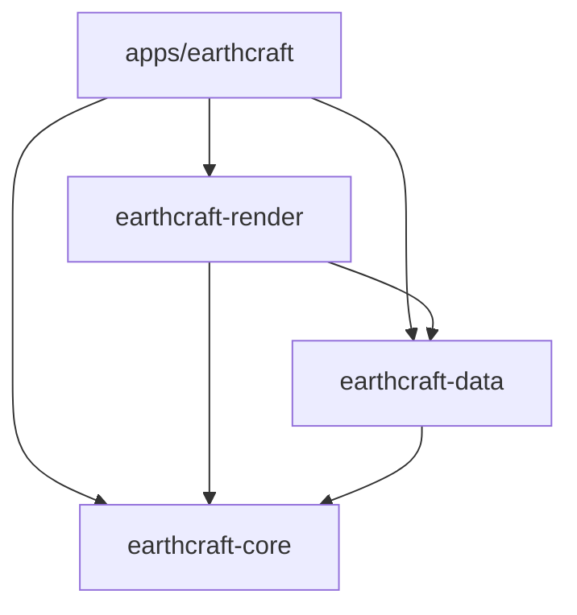

# Architecture

[English](ARCHITECTURE.md) | [Português (Brasil)](ARCHITECTURE.pt-BR.md)

EarthCraft 0.1.0 is a Cargo workspace with one desktop application and three libraries.

Libraries never depend on the application. The workspace manifest owns versions,
package metadata and build profiles; `Cargo.lock` pins resolved dependencies.
`apps/earthcraft` is the default member, so `cargo run --release` starts the app.

| Package | Responsibility | Entry points |
| --- | --- | --- |
| `earthcraft` | Native startup, input, UI state, font layout, styled shapes and texture upload | `main.rs`, `app/mod.rs`, `app/ui`, `app/rendering.rs`, `app/overlays` |
| `earthcraft-core` | Double-precision math, camera/picking/flight, Unicode name normalization, language, Fluent catalogs and placemarks | `camera`, `flight`, `math`, `language`, `localization`, `placemark` |
| `earthcraft-data` | Async HTTP, tiles, boundaries, local search, KML, settings and persistence | `runtime`, `http`, `tiles`, `boundaries`, `search`, `kml`, `files`, `settings` |
| `earthcraft-render` | CPU rasterization, frame scheduling, geographic overlay preparation and tile priorities | `worker`, `overlays` |

## Rendering and UI

The app captures immutable camera/style/layer inputs. A render-owned coordinator
holds one active job, one replaceable pending request and one completed frame.
Provider, release, size and style changes reject incompatible results; compatible
completed camera snapshots remain presentable during motion. Picking, borders,
labels and scale use the displayed camera, keeping input and overlays aligned.

CPU rasterization uses the shared Rayon pool, eight-row tile batches and `wide`
four-lane f64 rays. Geographic conversion and LOD stay in f64; glam handles camera
matrices/quaternions and SIMD colors. Batch-local tile handles avoid repeated cache
reads and are released after the batch. Safe bytemuck casts describe byte pixels;
workspace code forbids unsafe Rust. Native macOS menus stay in the desktop
adapter; their callbacks queue actions and wake egui. Windows and Linux use
sidebar controls. The sidebar can be collapsed from the persistent toolbar
button; its settings and sections remain available when reopened.

The coordinator prepares CPU image data and matching overlay geometry before
publication. Egui uploads textures and builds styled shapes on its own thread.
RGBA buffers are reused when uniquely owned; screenshots retain immutable `Arc`
snapshots, so an export never reads a recycled frame. PNG encoding runs on the
bounded file worker.

## Overlays and spatial indexes

Render owns geographic visibility, border projection and ordered label candidates.
A packed `geo-index` R-tree indexes immutable boundary-line bounds, with conservative
3D horizon/frustum tests and dateline/pole handling. Dataset changes rebuild the
index; camera changes query it. Source order and visible line interiors are preserved.

The app caches one displayed set of egui shapes/galleys. Camera, viewport, DPI,
altitude, dataset, layers, language and text scale invalidate it. Tile arrivals and
unrelated UI updates reuse unchanged projections. Stationary changes use a coalesced
overlay worker; moving frames carry their matching geometry. Font measurement,
final label occupancy and styled shapes remain on egui. Mutable `rstar` indexes
accepted screen rectangles in priority order, including touching-edge rejection,
padding and the 500-label limit. Placemarks and ruler edits remain immediate.

## Async services and files

The app owns one Tokio `ServiceRuntime` and injects handles/repaint callbacks.
Pooled reqwest clients enforce response limits, timeouts and retry policies.
Network I/O runs asynchronously; bounded feature, tile-decoding and file workers
separate CPU-heavy parsing from interactive imagery. Six async tile workers use
48-job admission, current-view priority and delayed retries; stale queued detail
is retired while active work and coarse overview jobs remain.

Boundary processors stream GeoJSON feature collections, share immutable coordinate
lines, merge/deduplicate patches, and publish immutable geometry/name snapshots.
Municipal geometry loads when its layers are enabled; labels can load independently.
Loaded-name prefix search uses background-built Unicode-normalized FST indexes,
with scanning during rebuilds. Ranking and remote-result merging remain explicit.

GeoRust `kml` owns XML reading/writing. A bounded quick-xml preparation pass skips
empty Points, balances incomplete containers and wraps bare-coordinate fragments.
KML I/O and screenshot encoding use an ordered bounded file service. Native dialogs
and result application belong to the app. Settings/language writes coalesce on a
filesystem worker and flush at shutdown; startup reads the small preference files.

## Cache ownership

| Storage | Policy |
| --- | --- |
| Decoded tiles | Moka `sync`, weighted LRU, 256 MiB best-effort target; temporary overshoot and frame references are separate |
| Encoded imagery | MBTiles 1.3 through one tokio-rusqlite worker; 128 MiB managed-file target, including SQLite overhead |

MBTiles separates providers, stable Wayback releases and encoded formats, converts
XYZ rows to TMS, and lazily imports legacy tile files. Eviction favors coarse
imagery and reclaims pages. Tiles publish before optional persistence. Clearing
removes only owned imagery files, rejects old-epoch writeback, preserves decoded
memory/settings/boundaries, and refreshes actual usage. SQLite R-tree/FTS5 support
is available for auxiliary catalogs; it is not duplicated in the tile hot path.

Satellite overview warming covers zooms 0–4 globally: 341 tiles, 85.25 MiB decoded.
It runs while idle at 14,000 km or farther away, after visible work, with bounded
admission. Other providers stay on demand. Cache roots resolve `LOCALAPPDATA`,
`XDG_CACHE_HOME`, `HOME/.cache`, then the temporary directory, under
`earthcraft_tiles`. Preferences remain `settings.json` and `lang.txt`.

## Units, localization and diagnostics

Coordinates use degrees, altitude/distances use kilometers, and raster footprints
use meters. KML/GeoJSON arrays are longitude-first; domain pairs are latitude-first.
UI strings live in embedded `locales/{en,pt-BR}.ftl`, with matching semantic keys
and named whole-message arguments. Errors/logs are English; normal UI messages
follow the selected language. See [localization](LOCALIZATION.md).

Opt-in profiling records pipeline and queue timings through a bounded background
recorder. Normal builds compile it out. Component results and native measurements
are documented separately; neither raster timing nor app-side texture submission
is an application FPS guarantee. See [contributing](CONTRIBUTING.md),
[CPU baseline](PERFORMANCE_BASELINE.md).

## Optional GPU Earth rasterization / renderização opcional em GPU

The Earth overview raster can be computed by the `earthcraft-render` `backend`
module with `wgpu` compute shaders (`gpu/`), then read back for the existing
egui view; the CPU path remains the default and fallback. Set
`EARTHCRAFT_RENDERER=auto` or `EARTHCRAFT_RENDERER=gpu` to enable a GPU attempt.
The Explorer, live meteorological/aircraft layers, moon and custom planet
remain integrated in `apps/earthcraft`. See [GPU_RENDERER.md](GPU_RENDERER.md)
for hardware limits, performance and CPU-only build instructions.

## Frontend boundaries for EarthCraft web

Core owns body selection, illustrative flight-route sampling and camera orbit/zoom
mapping. Render owns body meshes (positions/UVs/indices), weather compositing,
aircraft/ruler projection, scale-bar selection, raster sizing and frame keys.
These APIs use domain values, image buffers and `emath`, with no egui widgets,
texture handles or window objects. The desktop adapter uploads textures, measures
fonts, handles input and draws the returned geometry.

Data owns cloud/radar fetching, refresh/retry state, palette decoding, geographic
resource URLs and `.earthplanet` documents. Byte-oriented planet encode/decode APIs
support a frontend-provided legacy sidecar resolver; native path I/O is separate.
OS URL opening, speech commands and file dialogs remain desktop responsibilities.
This extraction prepares reusable logic; it does not make Tokio, SQLite, native
file services or GPU readback compile for WebAssembly. A web frontend still needs
browser transport/storage/execution adapters. Weather projection and body mesh
construction retain their current frontend scheduling; this PR does not add jobs.
